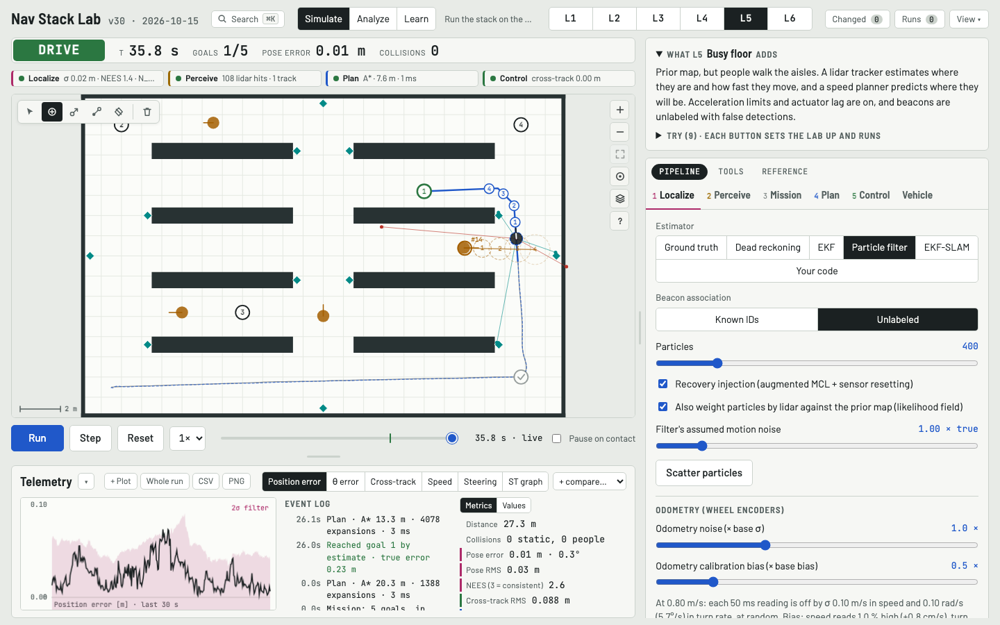

# Nav Stack Lab

A complete robot navigation stack in one HTML file: localization, perception, planning and control on a simulated
differential-drive robot or car, a linear loop-analysis view checked against the nonlinear simulator, and 31 guided
lessons with seven companion chapters whose numbers are measured, not asserted.

**Live demo:** https://spz0git.github.io/nav-stack-lab/ · or download
[`dist/nav-stack-lab.html`](dist/nav-stack-lab.html) and open it: it is a single 1.5 MB page with no runtime
dependencies and no network requests, so it works offline, on a phone and behind a blocker.



## What is inside

- **Simulate.** Seven levels on a 24 × 16 m floor at 20 Hz: open floor, warehouse aisles, noisy odometry, unknown
  building, busy floor with people and another vehicle, parking lot, and the moose test for the car with tyre slip. Pick an estimator (dead reckoning, EKF,
  particle filter, EKF-SLAM), a mapping mode (prior map or log-odds occupancy), a planner (A*, RRT*, Hybrid A*
  with Reeds–Shepp, space-time A*) and a tracker (pure pursuit, Stanley, rear-wheel feedback, PID, DWA, NMPC or
  LTV-MPC); or drop in your own controller, planner, localizer or predictor as JavaScript that runs in a Web
  Worker. Three vehicles: unicycle, kinematic bicycle, and a dynamic bicycle with tyre slip and a friction limit.
  A Foxglove-style workspace around it: one timeline that replays map, plots, metrics and the event log, map tools
  and layers, a plot dock over 33 signals, a command palette, health lights with reasons, runs kept and compared,
  parameter sweeps in parallel workers.
- **Analyze.** The tracking loop linearized about the path with the sampling, latency and actuator lag in the
  model: Bode, Nyquist, step and bias responses, root locus and draggable poles, with the margins read from the
  nonlinear simulator for comparison.
- **Learn.** 31 lessons in four groups (localization, perception, planning and the mission, the control loop), each
  with Try buttons that set the lab up and run, and seven chapters that derive the formulas (vehicle models,
  localization, perception, planning, path trackers, the lateral tracking loop, MPC), with live values from the
  current settings.

Known limits, stated up front: runs live in memory until the page closes (export keeps one); the health thresholds
are heuristics; NEES and the phantom-track rule use ground truth; one y-axis per plot pane; Compare works on runs
of the same level; the obstacle constraints of the MPC use a lidar snapshot. The design notes and the roadmap are in
[docs/roadmap.md](docs/roadmap.md).

## Run it locally

```sh
git clone https://github.com/spz0git/nav-stack-lab.git
cd nav-stack-lab
./build.sh                       # node build.mjs → dist/nav-stack-lab.html, dist/core-worker.js
open dist/nav-stack-lab.html     # or python3 -m http.server --directory dist
```

The build needs Node 18 or newer and nothing else (the TeX-to-MathML converter is vendored in `tools/vendor/temml`
and runs at build time only). `dist/` is committed, so the page at the head of `main` is always the one the demo
serves.

## Test it

The tests drive the built page headless with Playwright (Python) and need a Chromium:

```sh
python3 -m venv .venv && source .venv/bin/activate
pip install playwright && playwright install chromium
./build.sh
cd tests
python3 test.py        # L1–L5 regression: goals, contacts, mission time, pose error, NEES (the summary must not change)
python3 p5test.py      # every Try button of every lesson and level runs without a console error
python3 tles.py        # every lesson renders; the glossary covers every term
python3 chtest.py      # every chapter: live values fill, Try buttons run, derivation links go there and back
python3 dyntest.py     # the car with tyre slip against chapter 1's theory; Analyze against the simulator
```

The whole suite takes about three minutes. The headless core also runs in Node without a browser:
`node -e "..."` against `dist/core-worker.js` reproduces the page's runs (see `src/worker/main.js`).

## Contribute

Issues and pull requests are welcome: a new lesson, a chapter section, a planner heuristic, a signal, a bug with a
run export attached. The project's vision, what is accepted and the test gate every PR has to pass are in
[CONTRIBUTING.md](CONTRIBUTING.md); the release procedure is in [docs/maintaining.md](docs/maintaining.md).

### Source layout

One page, built from these modules by `node build.mjs`. The modules share one scope (they are concatenated in
`manifest.json` order inside an IIFE), so a function defined in `core/planning.js` can be called from `ui/map.js`
without imports. `core/` never touches the DOM; it reaches the page only through the hook object `UI` in
`core/state.js`, which is why the same core runs in Node and in the Experiments workers.

```
src/
  index.html        page markup; /*__FONTS__*/, /*__CSS__*/, /*__JS__*/ and /*__WORKER__*/ are filled by the build
  styles.css
  fonts/            the typefaces (woff2 Latin subsets, SIL OFL) embedded by the build; fonts.json lists them
  manifest.json     the module order (declaration order matters for const/let)
  version.json      the version label in the header
  core/             the simulation; no DOM
    constants.js    world size, grid, helpers, footprint geometry
    worlds.js       obstacle layouts, beacons, people, the six levels
    params.js       DEFAULTS, P (live parameters), LAYERS
    record.js       replay frames, ghost of the previous run
    state.js        S (simulation state), reset(), people motion
    config.js       loadLevel, setParam, kidnapTo, requestReplan
    vehicle.js      actuator chain + unicycle/bicycle integration
    sensors.js      lidar, beacons
    localization.js dead reckoning, EKF, particle filter
    slam.js         EKF-SLAM
    perception.js   log-odds mapping, costmap
    planning.js     A*, RRT*, smoothing
    planning-car.js Reeds–Shepp, Hybrid A*
    path.js         track projection, curvature
    mission.js      goal ordering, state machine
    controllers.js  pure pursuit, rear-wheel feedback, Stanley, PID, DWA
    mpc.js          NMPC / LTV-MPC
    dispatch.js     which controller runs
    custom-controller.js  user code in a Web Worker
    slots.js        the other code slots (planner, localizer, predictor)
    agents.js       agent detection, tracking, prediction, ST speed planning
    fidelity.js     sensor latency, reactive pedestrians, the other vehicle, the tyre model
    step.js         one simulation tick, advance()
    log.js          event log (data only)
  ui/               everything that touches the DOM or a canvas
  analysis/         linear loop analysis (num, model, plots, lessons, glossary)
  worker/main.js    headless runner: core/* + this file = dist/core-worker.js, embedded in the page
docs/notes/         the seven companion chapters (markdown + TeX), converted by tools/notes.mjs at build time
tests/              Playwright tests and the measurement scripts the lessons' numbers come from
```

### Companion notes and lessons

`docs/notes/*.md` are the chapters shown in Learn mode. They are markdown with TeX formulas, plus `{{live:key}}` for
numbers the app computes from the current settings (defined in `src/ui/chapters.js`) and
`[try: Label | {cfg}]` for buttons that set the simulator or the analysis up; the header of `tools/notes.mjs`
documents both. A lesson (`src/analysis/lessons.js`, `lessons2.js`) links to the section that derives its formula
with `<a class="chref" href="#notes=ch2/<section-slug>">`, and Back from the chapter returns to the lesson. A Try is
`['Label', cfg]` or, explained, `['Label', cfg, {setup, see, shows}]`; a lesson may carry `q: [[question, answer], …]`.
The numbers in a lesson's "What you will see" are measured headless first with the `tests/measure_*.py` scripts.

## Cite

If this lab is useful in a course or a paper, please cite it; [CITATION.cff](CITATION.cff) has the metadata GitHub
and Zenodo read.

## Licence

MIT, see [LICENSE](LICENSE). The vendored converter `tools/vendor/temml` and the embedded typefaces in `src/fonts/` keep
their own licences (MIT and SIL OFL 1.1); [NOTICE](NOTICE) lists them.
